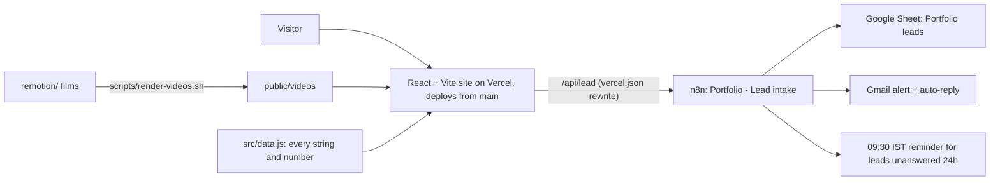

# MAP: status board and open to-dos

Read this first each session, then `CLAUDE.md`. Keep it current: update the board and to-dos whenever a change ships.

## System

## Status board

| Area | State | Where to read |
|---|---|---|
| Site, three service pages, Dusk design | Live | `docs/design-system.md`, `docs/system/01-website-map.md` |
| Contact form + lead intake | Live (n8n) | `n8n/README.md`, `docs/specs/n8n-lead-webhook.md` |
| Start flows + AI check funnel | Live | `docs/system/01-website-map.md`, `n8n/UPGRADE-2026-10.md` |
| Product films, sound toggle | Live | `docs/films.md` |
| Hosting | Vercel team `aniket-s1`, project `aniket-portfolio`, deploys from `main` | `docs/deploy.md` |
| Deploy runbook | Current | `docs/deploy.md` |
| Strategy, pricing, roadmap | Reference | `docs/system/02-service-catalog.md`, `docs/system/05-icp-positioning.md`, `docs/system/06-roadmap.md`, `docs/system/07-pricing-strategy.md` |

## Docs index

- [Website map: routes, data.js schema, pages](system/01-website-map.md) (keep in sync with code)
- [Service catalog and price bands](system/02-service-catalog.md)
- [ICP and positioning](system/05-icp-positioning.md)
- [Client landing engine](system/03-client-landing-engine.md) and [fulfillment system](system/04-fulfillment-system.md)
- [Roadmap](system/06-roadmap.md) and [pricing strategy](system/07-pricing-strategy.md)
- [Stack layers](stack-layers.md), [films](films.md), [conventions](conventions.md), [design system](design-system.md), [deploy](deploy.md), [docs index](README.md)

## Open to-do list

Everything under "Blocked on Aniket" below is open. Nothing else is tracked here yet; add items as they appear.

## History and blockers (moved from CLAUDE.md, dates kept as written)

### Blocked on Aniket

Branded domain (set `site.origin` in `data.js`; canonical, OG, JSON-LD,
robots.txt and sitemap.xml are generated from it by the `siteMeta` plugin in
`vite.config.js`) · `site.bookingUrl` (Cal.com; setting it makes "Book a
15-min call" the secondary button everywhere, beside the primary, see
`components/FunnelCta.jsx`; the plans' result screens then show "Book a
free call" first) · Vercel Web Analytics switched
on in the project dashboard (the script tag is already in production builds;
custom events need a plan that includes them) ·
a `Service` column in the "Portfolio leads" sheet (the form now sends `service`;
the live n8n workflow needs the column before it can file it) · case-study numbers · testimonial · CV PDF
and a real headshot (the `/about` page now exists and renders labelled slots for
both) · real screenshots.

**Funnel (2026-10-09, start flows).** The primary button is "Get started"
to `/start` (website, software or AI); each service page uses its own free
step 1: "Plan your website" (`/start/website`), "Plan your software"
(`/start/software`), "Get your free AI check" (`/ai-check`). All three
send leads through `/api/lead` with the contact form's fields
(`service` websites / software / ai, `source` start-website /
start-software / ai-check), so the n8n intake is unchanged. Questions in
`startFlows` / `aiCheck` (`data.js`), result rules in
`pages/start/rules.js` and `pages/aicheck/rules.js`; prices only ever
come from `packages`. Map: `docs/system/01-website-map.md`.
Prices: from-price on pages, package price only on flow results, since
2026-10-09 (one `services[].from` per area on every page, FAQ and JSON-LD;
the package and its price only on the result screens of the two plans (with
the Care Plan price) and the AI check (the AI Roadmap price), after the visitor
has left their details).
Leads (2026-10-09, funnel strategy): every lead keeps the original fields and
adds `phone` (normalised), `timing`, `package` (name + price shown),
`lead_temp` (hot / warm / cold, rules in `src/leadExtras.js`), `utm_source`,
`utm_medium`, `utm_campaign`, `landing_page` (first page of the session,
`?src=` counts as utm_source). Results have their own URLs
(`/start/website/result`, `/start/software/result`, `/ai-check/result`; a
refresh there goes back to the start) and their buttons follow `lead_temp`
(`pages/flow/NextStep.jsx`). n8n v2 reference: `n8n/UPGRADE-2026-10.md`.

Resolved 2026-09-11: real email and WhatsApp number are set in `src/data.js`, so every WhatsApp CTA is live.

Resolved 2026-09-27: the contact form is live. It posts to `/api/lead`, which
`vercel.json` rewrites (server-side, so the n8n host never reaches the
browser) to the "Portfolio — Lead intake" n8n workflow: Google Sheet "Portfolio
leads", Gmail alert and auto-reply, an error-alert workflow, and a 09:30 IST
reminder for leads unanswered after 24h (see `n8n/README.md`).
`VITE_LEAD_WEBHOOK_URL`, if set, overrides the rewrite; set it for local dev,
where the rewrite does not exist.
