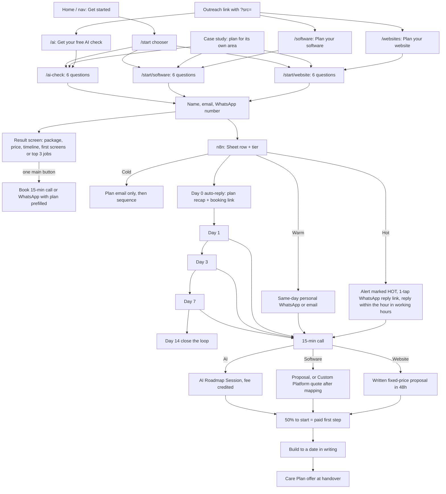

# Funnel strategy and flow spec (2026-10-09)

Goal: get a visitor from first visit to a paid first step, for websites, software and AI equally.
Based on main (`977936f`), the in-progress `start-flows` branch, `src/data.js` prices, `n8n/README.md` and the competitor audit of the same date. Uncommitted on purpose (public repo). No invented numbers: every figure below is a current price or something to measure.

## 1. Diagnosis: where visitors drop today

1. **Biggest leak: after they submit, nothing happens that a buyer can see.** The lead gets one generic email. Their phone number is optional and goes into the message text, so you can't sort or filter by it. There is no booking link (`site.bookingUrl` is empty). Nobody follows up if you are busy, and the 24h reminder goes only to you. A hot Indian lead who expected a WhatsApp reply gets an email and goes quiet.
2. **One door for three services (fixed by `start-flows`).** On main the nav, home and case-study buttons all say "Get your free AI check". A website or software buyer has no first step that fits, so they leave or fall back to a blank contact form.
3. **Service pages:** good proof and prices, but until `start-flows` ships, `/websites` and `/software` end in "talk to me", which is a big ask for a cold visitor.
4. **Projects / case studies:** the strongest "what's seen sells" pages, but they end on the AI check or contact. A visitor reading the software case (Care Journey Platform) should get "Plan your software". Check that `start-flows` maps each case to its own area (lane).
5. **Direct WhatsApp / LinkedIn outreach links** land on a service page with no `source` tag, so you can't tell later whether a sheet row came from outreach.
6. **Result screens** show the package but the next step is "WhatsApp" or "call" with no time attached, and nothing on the page says how fast you reply.

## 2. Target flow

**Message outlines** (plain words; every one follows stakes, question, headfake, rehook; stop as soon as Stage moves past "New"):

- **Result screen:** stakes ("enquiries waiting a day"), question ("what would it take to answer in a minute?"), headfake ("not a new app your team has to learn"), rehook ("here is what version one looks like; 15 minutes firms up the price and date"). Main button: book (WhatsApp until Cal.com exists). Show "I reply within one working day" only if you can keep it.
- **Day 0 auto-reply (email; WhatsApp once the API exists):** their answers in 3 lines, the package and its starting price, the guarantee line, the booking link, "or just reply here".
- **Day 1, you on WhatsApp (hot and warm):** "Saw your plan for [package]. One question before we talk: [the answer that matters most, e.g. 6 to 10 pages / payments]. Free tomorrow or Thursday?"
- **Day 3 email:** one real project that fits their area (an anonymised client case or a labelled demo), what it does, a link to its film.
- **Day 7 email:** the obstacle you hear most for that area, answered honestly (price is fixed in writing; you own the system; a person checks the AI).
- **Day 14 email:** "Should I close your plan? Reply 'later' and I'll check in after [their 'when' answer]." Then stop.
- **After the call:** a written proposal within 48h with fixed price, live date, the guarantee, 50/50 terms and the Roadmap credit where it applies. Follow up on Day 2 and Day 5 after sending, then stop.

## 3. Offer ladder (prices from `src/data.js`, unchanged)

| Service | Free first step | Next step | Build | Care |
|---|---|---|---|---|
| Websites | Website plan (`/start/website`) | Free 15-min call → proposal | Business Website from ₹35,000 / $1,200; + AI Assistant from ₹75,000 / $2,400 | Care Plan ₹15k–30k / $250–500 a month |
| Software | Software plan (`/start/software`) | Free call → proposal, or a quote after mapping (Custom Platform) | Internal Tool ₹1.5L–3L / $4,000–8,000; Custom Platform quoted | Care Plan |
| AI | AI check (`/ai-check`) | AI Roadmap Session ₹20,000 / $490, credited | Quick-Win ₹30k / $690; Sprint ₹40k–80k / $1,900–3,200; Assistant ₹80k–1.5L / $2,900–4,900 | Care Plan |

**Confusing spots to fix in the copy (prices stay as they are):**
- **Roadmap ₹20k vs Quick-Win ₹30k:** two paid first steps side by side. Say which is for whom: "you know the task" leads to Quick-Win, "you don't know where to start" leads to Roadmap. The AI check result should pick one of the two.
- **Sprint's INR floor (₹40k) is close to Quick-Win (₹30k)** for 3 to 5 jobs, while in USD the Sprint starts at almost 3x the Quick-Win. Your call whether that is on purpose.
- **Two "assistants"** (Website + AI Assistant from ₹75k, AI Assistant Build from ₹80k). Say it in one line: the first answers your site visitors, the second answers your team or WhatsApp.
- **Software has no small paid step.** Custom Platform buyers go from a free call straight to a large quote. A paid, credited scoping step like the Roadmap is an option, but only you can set its name and price.

## 4. Qualification (worked out in n8n from the answers)

- **Hot:** budget at or above the package's starting price **and** "when" is ASAP or within a month **and** a WhatsApp number was given. For AI only, also 30 or more enquiries a week, or a team of 3 or more. **What they get:** an alert marked [HOT] with a one-tap WhatsApp link, and a personal reply within the hour during working hours.
- **Warm:** budget fits but the timing is 1 to 3 months, or budget is "not sure" and timing is ASAP, or no phone number was given. **What they get:** a personal WhatsApp or email the same day, then the sequence.
- **Cold:** budget below the starting price (the result screen already says so), or "no fixed date yet". For AI, also 1 or 2 people with fewer than 10 enquiries a week. **What they get:** the automated sequence only, and a polite note pointing to the smallest offer that fits.

## 5. Measurement (weekly, free tools)

| # | Number | Where it's captured |
|---|---|---|
| 1 | Visitors to home, each service page and each case study | Vercel Web Analytics (page views) |
| 2 | Flow starts: views of `/start/website`, `/start/software`, `/ai-check` ÷ #1 | Vercel page views |
| 3 | Plans sent per flow, and plans sent ÷ flow views | Sheet, `Source` column (custom events need a paid plan; give the result screen its own address so page views count it) |
| 4 | Share of leads with a WhatsApp number, and the hot/warm/cold mix | Sheet (new `Phone`, `Tier` columns) |
| 5 | Time to first reply for hot leads | Sheet `First reply at` minus `Submitted At` |
| 6 | Calls held | Sheet `Stage` (Cal.com bookings once it exists) |
| 7 | Proposals sent, and paid first steps (count and ₹/$) | Sheet `Stage` and a `Value` column |
| 8 | WhatsApp chats per button | Your own tally from the prefilled opening lines (each one names the button) |

## 6. Build list (smallest change first)

**Now**
1. Ship `start-flows` (in progress). Effort M. Each service gets its own first step.
2. **Aniket:** create the Cal.com link and paste it into `site.bookingUrl` (`src/data.js`). Effort S. Every "book" button becomes real.
3. Send structured fields with every lead (`phone`, `when`, `budget_band`, `package`, `source`) from `src/pages/start/FlowPage.jsx`, `src/pages/AiCheckPage.jsx` and `src/leadWebhook.js`, and add the matching Sheet columns. Effort S. Needed for tiers and tracking.
4. In n8n: a Code node that works out the tier, puts [HOT] in the alert subject, and adds a `wa.me/<lead>?text=` reply link to the alert email. Effort S. Hot leads get answered in minutes.
5. Rewrite the auto-reply per service using the Day 0 outline. Effort S.
6. Result screen: one main button by tier; label the WhatsApp field "so I can send your plan there"; show the reply promise before submit (**Aniket** sets a time he can keep). Effort S.
7. Outreach links carry `?src=wa|li|email`, which goes into the `Source` column. Effort S.

**Next**
8. n8n daily job: sends the Day 1, 3, 7 and 14 messages based on the Sheet's `Next touch` column, stops on a Stage change, and sends you a morning WhatsApp to-do list. Effort M. Leads stop going cold in silence.
9. **Aniket:** proposal template (fixed price, date, guarantee, 50/50, Roadmap credit) and a payment link (UPI/Razorpay, Stripe). Effort M. Shortens call → paid.
10. Case-study call to action matched to the project's area (`src/pages/ProjectDetailPage.jsx`, if `start-flows` didn't do it). Effort S.
11. Give each result screen its own address so Vercel counts it. Effort S.
12. Price-ladder copy fixes from section 3 (`src/data.js`). Effort S, **Aniket decides**.

**Later**
13. **Aniket:** WhatsApp Business app (free): greeting and away messages, quick replies with the outlines above, Hot/Warm/Cold labels. Effort S. The API with automatic messages comes later (L, needs Meta setup).
14. **Aniket:** email from his own domain, so auto-replies don't land in spam. Effort S once the domain exists.
15. "Try a demo" on `/ai` (Appointment Desk / Website Answer Widget). Effort L.
16. A calculator for the cost of slow replies, using the visitor's own inputs only. Effort M.
17. Fill the testimonials slot once real ones are supplied. Effort S.
